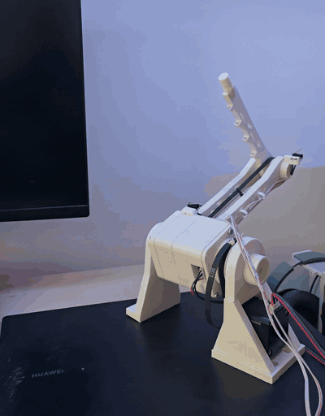

# 🦾 OpenSCARA

**An open-source, 3D-printed SCARA robot arm that draws with light.**
Two NEMA 17 steppers, two TMC2209 drivers and a BeagleBone Black turn
G-code (or any SVG drawing) into smooth, straight-line moves of the tip.

<p align="center"></p>

## 🌟 Highlights

- 🖨️ **Mostly 3D printed**: every printed part is here as STL, plus the editable Fusion design.
- 📐 **Thinks in millimetres**: tell it `scara line 250 50` and the tip moves there in a straight line, with the inverse kinematics done for you.
- 🧾 **Runs G-code**: `G0`, `G1`, `G28`, absolute and relative moves, with look-ahead so curves made of short segments flow as one smooth path.
- 🎨 **SVG to robot in three commands**: draw in Inkscape, convert, copy, run.
- 🏠 **Homes itself** on two endstops keeps every move inside safe joint limits, and checks a whole G-code file before anything moves.
- 🐧 **One SD-card image**: a small Buildroot Linux for the BeagleBone Black, ready to boot.
- 💡 **First use: light painting**. An RGB LED on the tip draws in the air for long-exposure photos, each stroke in its own colour (`M150`).

## ℹ️ Overview

OpenSCARA is a two-joint SCARA arm (a "shoulder" and an "elbow" moving in
a horizontal plane). Each joint is driven by a NEMA 17 stepper through a
GT2 belt: 20T to 72T on the shoulder, 20T to 45T on the elbow. The links
are 195.4 mm and 166.4 mm long, so the tip reaches up to 361.8 mm from
the shoulder axis.

A BeagleBone Black runs the whole thing. It talks to both TMC2209 drivers
over one shared UART line (current, microstepping, quiet stealthChop
mode), sends the STEP/DIR pulses itself, and reads one endstop per joint.
On top of that sits `scara`, a small C program that converts X/Y in
millimetres to joint angles and back, plans straight lines and runs
G-code files. On the PC side, two plain Python scripts turn an SVG into
G-code and copy it to the board.

### ✍️ Author

OpenSCARA is built by **jo** ([@jonardan](https://github.com/jonardan)):
the mechanics, the electronics and the software, designed and tested on a
real arm. It started as a way to make long-exposure light drawings with
a robot, and grew into a small, hackable arm controller you can read in
an afternoon.

## 🚀 Usage

Once the arm is wired and booted (see Installation below),
open the board's console from the PC and:

```bash
scara home                                   # find the endstops
scara line 250 50                            # straight line to X250 Y50 (mm)
scara gcode /usr/share/scara/spiral.gcode    # draw a spiral
```

Draw by hand inside the arm's reach: open `tools/disegna.html` in a
browser, draw with a colour per stroke, and save the G-code, or, in
Chrome or Edge with the board on the USB cable, press "Disegna sul robot"
and it draws straight away (details in the drawing guide). The tip always
stays above the X axis, on the side away from the table (`max_y_mm`).

Draw your own picture from an SVG, on the PC:

```bash
python3 tools/svg2gcode.py drawing.svg -o drawing.gcode   # convert
python3 tools/bbb_send.py drawing.gcode                    # copy to the board
```

then on the board, check it and draw it:

```bash
scara gcode -n /root/drawing.gcode   # check only: reach and limits
scara gcode /root/drawing.gcode      # draw (Ctrl-C stops)
```

X/Y are millimetres from the shoulder axis; `0 0` in joint angles is the
arm straight along +X. Every command, option and setting is in the
📖 [command reference](docs/commands.md), and the Inkscape tips are in the
🎨 [drawing guide](docs/drawing.md).

### 🏠 Homing

<p align="center"></p>

`scara home` homes the elbow first, so the arm is folded before the
shoulder swings, then the shoulder. Each joint turns toward its switch,
backs off 5 degrees, comes back slowly and stops on the click. If a
switch never clicks it stops with an error after one turn, so an
unplugged switch can't wind the arm into its hard stop.

## ⬇️ Installation

### What you need

| | |
|---|---|
| 🖨️ Printed parts | the STL files in [`hardware/`](hardware/) |
| ⚙️ Motion | 2 × NEMA 17 steppers, GT2 belts, 2 × 20T motor pulleys |
| 🔌 Electronics | BeagleBone Black, 2 × BIGTREETECH TMC2209 V1.3, 2 endstop switches, 12 V supply, 2 × 100 µF / ≥25 V capacitors, 1 kΩ resistor, microSD card |
| 💻 PC | Linux with [Buildroot](https://buildroot.org) 2026.05.3 to build the image, `picocom` for the console, Python 3 (standard library only) for the drawing tools |

### Steps

1. **Print and assemble** the parts in [`hardware/`](hardware/).
2. **Wire** the board, drivers, motors and endstops following the
   🔌 [wiring guide](software/README.md).
3. **Build the image** from the Buildroot source directory, pointing it at
   the `software/` folder of this repo:

   ```bash
   make BR2_EXTERNAL=/path/to/OpenSCARA/software robotarm_defconfig
   make
   ```

4. **Write it to a microSD card** (check the device with `lsblk` first):

   ```bash
   sudo dd if=output/images/sdcard.img of=/dev/sdX bs=4M conv=fsync status=progress
   ```

5. **Boot** the BeagleBone from the card (hold S2 while plugging in the
   mini-USB), then open the console. Login is `root`, no password.

   ```bash
   picocom -b 115200 /dev/ttyACM0
   ```

6. **Calibrate** the homing direction, home angles and joint limits for
   your arm with the 🛠️ [bring-up guide](software/board/beaglebone/readme.txt).

## 📚 Learn more

| | |
|---|---|
| 📖 [docs/commands.md](docs/commands.md) | every `scara` and `tmc2209ctl` command, G-code support, all settings |
| 🎨 [docs/drawing.md](docs/drawing.md) | from an Inkscape drawing to the arm |
| 🔌 [software/README.md](software/README.md) | wiring: pins, drivers, power, endstops |
| 🛠️ [software/board/beaglebone/readme.txt](software/board/beaglebone/readme.txt) | build, flash, bring-up and calibration |
| 🖨️ [hardware/README.md](hardware/README.md) | printed parts and the Fusion design |
| 🗺️ [docs/plan.md](docs/plan.md) | how the project was built, step by step |
| 📘 [GLOSSARY.md](GLOSSARY.md) | the words used in this repo |

| Folder | What is in it |
|---|---|
| [`software/`](software/) | Buildroot tree for the BeagleBone image: `tmc2209ctl` and `scara`, the config, the device tree |
| [`tools/`](tools/) | PC side: SVG to G-code, copying files to the board, example drawings |
| [`hardware/`](hardware/) | STL and Fusion files of the printed parts |
| [`docs/`](docs/) | guides, the plan, GIFs |

## 🚧 Not done yet

- The square test comes out slightly rotated and long, probably from
  loose belts; it will be redone once they are tensioned.

## 💭 Feedback and contributing

Built one, drew something cool, or found a bug? Please
[open an issue](https://github.com/jonardan/OpenSCARA/issues); photos of
light drawings are especially welcome! Pull requests are welcome too:
fixes, new G-code features, better printed parts, or clearer docs.

## 📜 License

[Apache 2.0](LICENSE)
