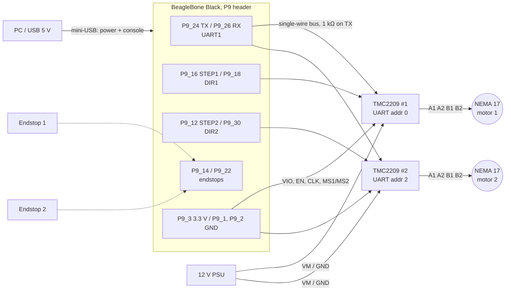
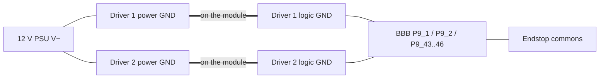

# OpenSCARA wiring

How the BeagleBone Black (BBB), the two BIGTREETECH TMC2209 V1.3 drivers, the
two NEMA 17 motors, the endstops and the power supplies connect.

Sources of truth, in this order:

- `package/tmc2209ctl/tmc2209.conf`: STEP/DIR pins and UART addresses the program uses
- `board/beaglebone/dts/ti/omap/am335x-boneblack-tmc2209.dts`: pin muxing
- `board/beaglebone/readme.txt`: build, flash and bring-up guide

If this file disagrees with those, they win; please fix this file.

> **Power everything off while wiring.** Never plug or unplug a motor while
> 12 V is on: it destroys the driver.

## Overview



## Pin table

### BeagleBone Black P9 header

| BBB pin | Signal | Goes to | Notes |
|---|---|---|---|
| P9_1 | GND | both drivers: EN, CLK; driver 1: MS1, MS2; driver 2: MS1 | EN low = driver on; enable/disable is done over UART |
| P9_2 | GND | both drivers: logic GND (power header pin 8) | |
| P9_3 | 3.3 V | both drivers: VIO | 3.3 V only, never P9_5..P9_8 (5 V) |
| P9_4 | 3.3 V | driver 2: MS2 | sets driver 2 to UART address 2 |
| P9_16 | GPIO1_19 | driver 1: STEP | |
| P9_18 | GPIO0_4 | driver 1: DIR | |
| P9_12 | GPIO1_28 | driver 2: STEP | moved here from P9_28, see below |
| P9_30 | GPIO3_16 | driver 2: DIR | |
| P9_24 | UART1_TX | 1 kΩ resistor, then PDN_UART of both drivers | one resistor for both |
| P9_26 | UART1_RX | PDN_UART of both drivers, directly | |
| P9_14 | GPIO1_18 | endstop 1 (motor 1) | input, internal pull-up |
| P9_22 | GPIO0_2 | endstop 2 (motor 2) | input, internal pull-up |
| P9_43..P9_46 | GND | endstop common | any BBB GND works |
| P9_28 | (HDMI audio) | **nothing** | stuck at ~3.3 V on this board, never use |

### TMC2209 drivers

| Driver pin | Driver 1 (motor 1) | Driver 2 (motor 2) |
|---|---|---|
| EN | GND | GND |
| MS1 | GND | GND |
| MS2 | GND | 3.3 V (P9_4) |
| UART address (MS1 + 2·MS2) | **0** | **2** |
| PDN_UART (pin 4) | shared UART bus | shared UART bus |
| pin 5 | open | open |
| CLK | GND | GND |
| STEP | P9_16 | P9_12 |
| DIR | P9_18 | P9_30 |
| VM | 12 V PSU V+ | 12 V PSU V+ |
| GND (next to VM) | 12 V PSU V− | 12 V PSU V− |
| A1 / A2 | motor 1 coil A | motor 2 coil A |
| B1 / B2 | motor 1 coil B | motor 2 coil B |
| VIO | 3.3 V (P9_3) | 3.3 V (P9_3) |
| GND (logic side) | P9_2 | P9_2 |

In UART mode MS1/MS2 only set the address; microstepping, current and
stealthChop/spreadCycle are set by `tmc2209ctl` from `/etc/tmc2209.conf`
(defaults: 600 mA RMS, 50 % hold, 1/16 microsteps, stealthChop).

## Signals

```
BEAGLEBONE BLACK P9                               DRIVER 1  (address 0)
                                                  +-----------------+
P9_1  GND      o─────────────────────────┬────────┤ 1  EN           |
                                         ├────────┤ 2  MS1          |
                                         ├────────┤ 3  MS2          |
P9_24 UART1_TX o──[ 1 kΩ ]──┐            │        |                 |
                            ├── BUS ─────┼────────┤ 4  PDN_UART     |
P9_26 UART1_RX o────────────┘    │       │        | 5  (open)       |
                                 │       ├────────┤ 6  CLK          |
P9_16 GPIO1_19 o─────────────────┼───────┼────────┤ 7  STEP         |
P9_18 GPIO0_4  o─────────────────┼───────┼────────┤ 8  DIR          |
                                 │       │        +-----------------+
                                 │       │
                                 │       │        DRIVER 2  (address 2)
                                 │       │        +-----------------+
                                 │       ├────────┤ 1  EN           |
                                 │       ├────────┤ 2  MS1          |
P9_4  3.3V     o─────────────────┼───────┼────────┤ 3  MS2          |
                                 └───────┼────────┤ 4  PDN_UART     |
                                         │        | 5  (open)       |
                                         └────────┤ 6  CLK          |
P9_12 GPIO1_28 o──────────────────────────────────┤ 7  STEP         |
P9_30 GPIO3_16 o──────────────────────────────────┤ 8  DIR          |
                                                  +-----------------+
```

Never ground PDN_UART: the UART stops answering. A driver only answers on
UART while its VM (12 V) is present.

## Power and motors

Same for both drivers:

```
                                                  RIGHT header (power)
                                                  +-----------------+
12V PSU  V+  o───────────────────┬────────────────┤ 1  VM           |
                            (+) ===  100 µF        |                 |
                            (-) ===  >= 25 V       |                 |
12V PSU  V-  o───────────────────┴────────────────┤ 2  GND          |
                                 ┌────────────────┤ 3  A2           |
          NEMA 17 coil A ────────┴────────────────┤ 4  A1           |
                                 ┌────────────────┤ 5  B1           |
          NEMA 17 coil B ────────┴────────────────┤ 6  B2           |
BBB P9_3  3.3V o──────────────────────────────────┤ 7  VIO          |
BBB P9_2  GND  o──────────────────────────────────┤ 8  GND          |
                                                  +-----------------+
```

- **BBB**: powered from its mini-USB cable (which is also the serial console,
  `/dev/ttyACM0` on the PC). Never feed 12 V to any BBB pin.
- **Motors**: both drivers' VM and GND go to the same 12 V supply, with a
  100 µF / ≥25 V electrolytic across VM and GND right at each module.
- **Coils**: find the two coil pairs of each NEMA 17 with an ohmmeter (a pair
  reads a few ohms, wires from different coils read open). One pair goes to
  A1/A2, the other to B1/B2. If a motor turns the wrong way, swap the two
  wires of one coil, or set `invert_dir = 1` for that motor in
  `/etc/tmc2209.conf`.
- **Current**: start low. A typical NEMA 17 is 1.0 to 1.7 A peak; RMS = peak / 1.41.

## Grounds

All grounds must be common. The TMC2209 module connects its two GND pins
internally, so wiring the logic GND to the BBB (P9_2) and the power GND to the
12 V supply V− joins them. Do not add a separate wire from the PSU V− to the BBB.



## Endstops

The device tree muxes P9_14 and P9_22 as GPIO inputs with the internal
pull-up. Each motor's switch is `endstop_line` in `tmc2209.conf`;
`endstop_nc = 1` if it is wired COM/NC.

| Endstop | BBB pin | GPIO | Other side |
|---|---|---|---|
| Motor 1 | P9_14 | GPIO1_18 (gpio 50) | GND (P9_43..P9_46) |
| Motor 2 | P9_22 | GPIO0_2 (gpio 2) | GND (P9_43..P9_46) |

Wiring: a mechanical switch between the pin and GND, using the
internal pull-up (pin reads 1 when open, 0 when pressed). Use the switch's
COM and NO contacts. For NC (safer: a broken wire reads as "triggered"), use
COM and NC instead and invert the logic in software.

```
P9_14 GPIO1_18 o────────o/ o────────o P9_44 GND     endstop 1 (COM / NO)
P9_22 GPIO0_2  o────────o/ o────────o P9_46 GND     endstop 2 (COM / NO)
```

Rules: BBB inputs are 3.3 V only. Do not use a 3-wire endstop board powered
from 5 V or 12 V (common on 3D-printer kits) unless its signal is 3.3 V.

Check the switches from the BBB shell:

```
tmc2209ctl endstop          # motor 1: released (P9_14 [ehrpwm1a] = 1) ...
tmc2209ctl endstop watch    # print every press/release until Ctrl-C
```

Or the raw lines with the libgpiod tools:

```
gpioget $(gpiofind "P9_14 [ehrpwm1a]")    # motor 1: 1 = open, 0 = pressed
gpioget $(gpiofind "P9_22 [spi0_sclk]")   # motor 2
```

## Homing

`tmc2209ctl home` homes motor 2 (elbow) and then motor 1 (shoulder):
each joint turns toward its switch, backs off 5°, comes back slowly and
stops on the click. More than one joint revolution without a click is an
error, so an unplugged switch can't wind the arm into its hard stop. The
direction toward each switch is `home_dir` in `tmc2209.conf`; it starts at
0 (homing refuses to run) until checked on the arm, see
`board/beaglebone/readme.txt`. After homing, `/run/scara.pos` holds each
motor's position and a homed flag.

## Joint angles

`scara` is the arm-level program (built from the same package, sharing the
driver code in `tmc2209.c`). `scara joint A1 A2` moves the shoulder and
elbow to absolute angles together, `scara jog J DEG` turns one joint
relative to where it is, and `scara where` prints the angles. Joint moves
need homing and stay inside `min_angle`..`max_angle` from `tmc2209.conf`.
How to measure `home_angle` and the limits on the arm:
`board/beaglebone/readme.txt`, "Joint angles: scara".

## X/Y

`kinematics.c` converts joint angles to the tip X/Y (mm, from the shoulder
axis) and back, using `link1_mm` / `link2_mm` from `tmc2209.conf`. It has no
hardware code and is tested on the PC with `make test` in
`package/tmc2209ctl/src`. `scara fk A1 A2` and `scara ik X Y [+|-]` print the
conversion without moving; `scara where` prints the tip X/Y once homed.
`scara goto X Y [+|-]` moves the tip there (IK, then the `joint` move).
`scara line X Y [F]` goes there in a straight line at F mm/s: `line.c`
splits it into 1 mm segments with IK at each point (host-tested too), and
`move_path` in `tmc2209.c` streams them through one stepping loop that
accelerates only at the ends of the line.

## Why STEP 2 is on P9_12 and not P9_28

P9_28 is wired to the HDMI chip as an audio data line (McASP0 AXR2). Even with
HDMI audio disabled in the device tree it stayed at ~3.3 V when driven low
(measured 2026-10-09 with the shield removed), so motor 2 never got a STEP
pulse. STEP 2 moved to P9_12 (commit f9df4e6). HDMI audio stays disabled; HDMI
video still works. **Do not use P9_28.**

## P9 pins that do not work for STEP/DIR/endstops

| Pins | Why |
|---|---|
| P9_1..4, P9_43..46 | power / GND |
| P9_5..10 | 5 V, power button, reset |
| P9_19, P9_20 | I2C2 (cape EEPROM) |
| P9_24, P9_26 | UART1, the TMC bus |
| P9_25, P9_28, P9_29, P9_31 | HDMI audio (P9_28 also stuck high) |
| P9_32..40 | analog (AIN, max 1.8 V, inputs only) |
| P9_41, P9_42 | each wired to two processor pins |

Still free after the endstops: P9_11, 13, 15, 17, 21, 23, 27.
